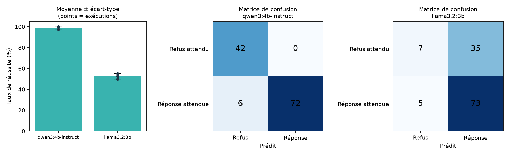

# Assistant de scolarité par agent IA – ISET Charguia

Agent qui répond aux questions des étudiants (absences, rattrapages, stages,
réclamations) **uniquement** à partir du règlement des études et du
calendrier des examens (`data/`, documents fictifs), en français, anglais,
arabe et derja tunisienne. Modèles gratuits en local avec Ollama
(`qwen3:4b-instruct`, comparé à `llama3.2:3b`). Aucune clé d'API dans le code.

> Principe central : **le modèle décide, le programme contrôle et agit.**
> Le modèle ne peut ni exécuter un outil, ni envoyer une demande, ni écrire
> une date : ces actions sont faites (et vérifiées) par le programme ou par
> l'étudiant.

## Fonctionnalités

| Exigence du sujet | Réalisation |
|---|---|
| Répondre en citant l'article | « Article N » cité ; chaque article est **cliquable** (texte officiel) |
| Dates d'examen et de rattrapage | Outil calendrier ; la date est écrite **par le programme** |
| Rédiger une demande administrative | Outil `generer_demande` : **brouillon** uniquement |
| Hors sujet / « je ne sais pas » / pas d'invention | Filtrage, prompts stricts, refus imposé par le programme |
| Serveur MCP | `mcp_server.py` (3 outils, aucun outil d'envoi) |
| Interface Streamlit affichant les étapes | `app_streamlit.py` + panneau « Cerveau de l'agent » |
| Bonus : arabe / derja | Détection de la langue, réponse dans la langue de la question |
| Bonus : envoi par mail après accord | Bouton « Confirmer l'envoi » (SMTP, sinon mode démonstration) |
| Bonus : mémoire | Limitée au déroulement d'une demande administrative |

## Architecture

```
Étudiant ─► app_streamlit.py (Streamlit) ─► web/index.html ─► server.py (FastAPI)
                                                              ─► src/main.py : run_agent
                                                        │
              1. le MODÈLE décide d'appeler un outil    │  boucle écrite à la main
              2. le PROGRAMME l'exécute (execute_tool)  │  (pas de framework)
                                                        ▼
                                                   src/tools.py
                                  search_reglement · get_calendrier · generer_demande
                                                        ▲
                                   mcp_server.py (serveur MCP, mêmes outils)
```

- `src/main.py` : langue, filtrage hors-sujet, recherche dans les documents,
  boucle d'agent (5 tours max), validation des arguments JSON, outils inconnus
  refusés. Le programme vérifie que le nom et le numéro étudiant figurent
  vraiment dans le message de l'étudiant (rien n'est inventé).
- `src/tools.py` : **seule** implémentation des 3 outils.
- `mcp_server.py` : expose ces 3 outils via MCP (FastMCP, transport stdio).
- `server.py` : API FastAPI (`/api/chat`, `/api/article/{n}`, `/api/articles`,
  `/api/compare`, confirmation / annulation d'un brouillon).
- `web/index.html` : interface (thème repris du portail étudiant ISET).

### Validation humaine

`generer_demande` ne crée qu'un **brouillon**. Aucun outil d'envoi n'existe
côté modèle ; l'envoi se fait par `POST /api/demande/{id}/confirmer`, appelé
par le bouton « Confirmer l'envoi ». Un brouillon annulé ne peut plus être
envoyé, un brouillon envoyé ne peut pas l'être deux fois. Sans SMTP configuré,
la demande est seulement enregistrée dans `demandes_envoyees/`
(démonstration, aucun message réel).

## Interface

- **Étapes de l'agent** : « Voir les étapes de l'agent » sous chaque réponse.
- **Cerveau de l'agent** (panneau de droite) : chronologie *modèle décide* →
  *programme exécute / contrôle* → *humain valide*, avec les articles lus.
- **Sources cliquables** : un clic sur « Article N » affiche le texte
  officiel du règlement.
- **Comparer les modèles** : même question, même recherche, mêmes contrôles ;
  seul le modèle change (badges : article cité, article inventé, refus).

## Installation et lancement

```bash
ollama pull qwen3:4b-instruct
ollama pull llama3.2:3b                # pour la comparaison et l'évaluation
pip install -r requirements.txt        # openai, fastapi, uvicorn, streamlit
pip install -r requirements-mcp.txt    # mcp>=1.2,<2

streamlit run app_streamlit.py         # interface Streamlit (http://localhost:8501)
python server.py                       # interface web seule : http://127.0.0.1:8000
python mcp_server.py                   # serveur MCP (stdio)
python demo_mcp.py                     # client MCP : liste et appelle les outils
npx @modelcontextprotocol/inspector python mcp_server.py   # inspection (Node.js)
```

`app_streamlit_native.py` est une version 100 % Streamlit (composants natifs).

Variables d'environnement (toutes optionnelles, voir `.env.example`) :

| Variable | Rôle |
|---|---|
| `SMTP_HOST`, `SMTP_PORT`, `SMTP_USER`, `SMTP_PASSWORD`, `SCOLARITE_EMAIL` | Envoi réel des demandes confirmées |
| `DATE_DEMANDE` (ex. `12/01/2027`) | Date de la lettre en démonstration : le calendrier est fictif (janvier 2027). Sans cette variable : date du jour |
| `COMPARE_MODELS` | Modèles de la comparaison (défaut : `qwen3:4b-instruct,llama3.2:3b`) |

Aucune clé n'est écrite dans le code ; `.env` est exclu de Git.

## Tests et évaluation

```bash
python -m unittest discover -s tests -p "test_*.py"    # sans Ollama
python tests/evaluer_repetee.py --runs 3               # jeu de développement (40 questions)
python tests/evaluer_repetee.py --jeu inedit --runs 3  # jeu inédit (15 questions)
python tests/evaluer_repetee.py --from-csv evaluation_repetee.csv   # recalcul sans relancer
python tests/voir_echecs.py evaluation_inedit.csv 103,109           # réponses des échecs
```

- `tests/jeu_de_test.py` : **40 questions** (12 factuelles, 5 hors sujet,
  6 information absente, 6 pièges, 6 manipulations du prompt, 3 multilingues,
  2 demandes) avec critères automatiques.
- `tests/jeu_de_test_inedit.py` : **15 questions jamais vues** (test set). Elles
  n'ont pas servi à corriger l'agent, qui n'a pas été modifié pour les réussir.
- `tests/evaluer_agent.py` : évalue l'agent complet (même chemin que l'interface).
- `tests/evaluer_repetee.py` : répète l'évaluation (moyenne ± écart-type, IC 95 %),
  matrice de confusion « refuser / répondre », comparaison des deux modèles.

### Résultats (3 exécutions par modèle)

| Jeu | qwen3:4b-instruct | llama3.2:3b | Fichiers |
|---|---|---|---|
| Développement (40 q.) | **99,2 %** (± 1,4 pt) | 52,5 % (± 2,5 pt) | `evaluation_repetee.csv`, `resultats_evaluation_repetee.md` |
| **Inédit (15 q.)** | **86,7 %** (IC ≈ 62–96 %) | 51,1 % (± 3,8 pt) | `evaluation_inedit.csv`, `resultats_evaluation_inedit.md` |



- qwen ne répond jamais à une question qu'il devait refuser (rappel du refus
  100 %) ; llama répond depuis ses connaissances générales et peut inventer une
  source (« Article L. 2121-1 du Code… » pour une question hors sujet).
- Sur le jeu inédit, qwen échoue sur deux questions : **#103** (cite l'article 4
  au lieu de l'article 8) et **#109** (conclut « non » alors que 5 jours ≤ 7).
  L'écart entre le jeu de développement et le jeu inédit (−12,5 pt) montre
  que le jeu de développement a servi à corriger l'agent.
- Les temps varient avec la charge de la machine : à lire à titre indicatif.
- Les autres `evaluation_*` / `resultats_*` de la racine sont des exécutions
  intermédiaires ; `evaluation_historique/` conserve l'état avant corrections.

Les questions de date d'un module sont répondues par le programme (sans
modèle) : elles réussissent donc quel que soit le modèle.

## Limites connues

- Recherche par mots-clés (pas de ChromaDB / embeddings) : une formulation
  éloignée du règlement peut échapper à la recherche (ex. « Je suis malade »
  seul ne retrouve aucun article). Un bug du même genre (« hospitalisé » sans
  le mot « examen ») a été trouvé à l'usage et corrigé.
- Un petit modèle peut se tromper sur un raisonnement numérique (#109) ou
  oublier de citer le bon article (#103) : ces cas devraient être calculés par
  le programme (piste d'amélioration).
- Évaluation : critères textuels (une bonne réponse reformulée peut échouer),
  15 questions seulement dans le jeu inédit.
- Mémoire de conversation limitée au déroulement d'une demande
  administrative (6 derniers messages) : poser une question complète sinon.
- L'agent appelle les outils directement (même processus), pas via un client
  MCP ; le serveur MCP expose les mêmes outils.
- Documents fictifs, aucune donnée personnelle réelle dans le dépôt.

## Structure du dépôt

```
app_streamlit.py   server.py   mcp_server.py   demo_mcp.py
src/               main.py (agent), tools.py (outils)
web/               index.html (interface)
data/              règlement et calendrier fictifs
tests/             jeux de test, évaluation, tests unitaires
captures/          captures d'écran pour le rapport
evaluation_historique/   évaluations avant corrections
```